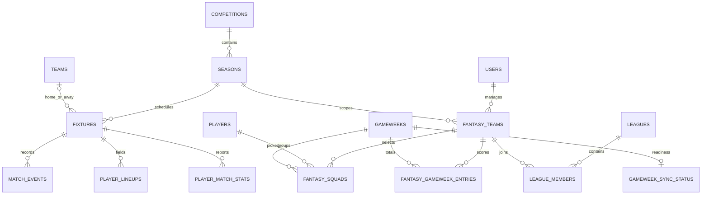

# Touchline database • schema, joins and operations

[Team home](MASTER.md) · [Writers and schedules](touchline_sync.md) · [API contracts](touchline_api.md) · [Client storage](touchline_main.md)

**Source • 23 November 2026.** This describes the schema versioned in `touchline/db/migrations` at `4c550f7` and how the inspected API and clients use it. A migration committed to Git and a migration applied to a particular Supabase project are separate facts. Some migration comments report prior manual application. Verify the environment’s Flyway history, effective grants and actual rows before claiming parity.

## Storage boundaries and ownership

| Boundary | Writer | Readers and purpose |
|---|---|---|
| Supabase Auth | Auth service | The app receives a session and the API verifies its token. The JWT subject links an identity to a fantasy manager. |
| PostgreSQL `football` | Worker role `sync_worker_user` | The API role reads reference data and match facts. Existing web functions read through Supabase’s Data API using server-side settings. |
| PostgreSQL `sync` | Worker role | Operational journal, gameweek readiness and article cache. The API role reads status. The web news function consumes the RSS cache. |
| PostgreSQL `app` | API role `app_api_user` | Owns managers, gameweeks, picks, leagues and scoring. Sync has a narrow grant to read `app.gameweeks` for completeness. |
| Separate Prisma-managed news model | Node news service | Expo’s news endpoint reads tagged, categorised articles. Its `DATABASE_URL` determines actual placement. Verify whether it shares a physical Postgres instance. |
| Web-local and legacy datasets | Browser prototype and older Main services | Web-local accounts/drafts, earlier `public`-schema SQL and fantasy RPC proposals have different IDs and contracts. Inventory data requiring migration before consolidation. |

Runtime role names refer to database logins. Fan authorisation takes place in the API. V037’s row-level security policies allow its service role to access all rows of seven fantasy tables, subject to table grants. This makes controller ownership and membership checks essential. Anonymous clients should never receive a service-role key or SQL connection string. V034 explicitly grants SELECT/INSERT on price history. Default privileges in V028 apply to future objects created by the migration owner. Inspect effective privileges when relying on append-only behaviour, especially for newer tables that may inherit UPDATE as well as explicit grants.

## How the tables fit together



The diagram shows the core foreign keys. Two other joins are **logical**. A fixture belongs to a fantasy gameweek through the same season and its kickoff’s SAST date. A lineup or event identifies a player by provider ID. Neither join is a direct foreign key to the fantasy gameweek or internal player row.

### Football dictionary

| Table | One row represents | Important keys, data and consumers |
|---|---|---|
| `football.competitions` | A provider league/competition | Internal `id`, unique `sportmonks_competition_id`, name and metadata. PSL lookup starts with provider ID 806. |
| `football.seasons` | One season of a competition | Unique provider season ID, FK `competition_id`, start/end, `is_current`, finished/pending. Use the internal ID for API joins. |
| `football.teams` | A real club | Unique provider club ID, name, short code, crest path, placeholder flag. A club can appear on either side of fixtures. |
| `football.players` | A real player | Unique provider player ID, names, position, nationality and image. No current-club column. API derives club from most recent eligible lineup in the season. |
| `football.fixtures` | A match | Unique provider fixture ID, competition/season FKs, nullable home/away club FKs, `starting_at`, state, scores, penalties and length. Unknowns must survive import as null. |
| `football.match_events` | One event in a fixture | Unique provider event ID, fixture FK, club, type, minute, extra minute, provider player and related-player IDs, rescinded flag. Goal and substitution interpretation depends on type. |
| `football.player_lineups` | A player’s team sheet entry in a fixture | Unique provider lineup ID, fixture/club, `sportmonks_player_id`, position, jersey and type. Supplies current club and evidence for minutes. |
| `football.player_match_stats` | A provider statistic for a fixture/side | Unique provider stat ID, fixture FK, optional team, type, value and location. There is **no player ID column**. A team statistic cannot be assigned directly to an individual fantasy pick. |

### Sync dictionary

| Table | Keys and lifecycle |
|---|---|
| `sync.sync_jobs` | One Python job, integer ID, job type, start/end timestamps, status and error. Allowed statuses include running, success, failed and unknown. Indexed by type/status. |
| `sync.sync_logs` | Many timestamped level/message records per job through `sync_job_id`. Used to find the last completed import stage. |
| `sync.gameweek_sync_status` | Unique `gameweek_id` → `app.gameweeks.id`. Separate fixture/event/stat flags plus sticky `marked_complete`. A missing status row is different from a final result. Written by the Python path. |
| `sync.news_cache` | Unique `cache_key`, JSONB `response`, `fetched_at` and `expires_at`. Created under `app` in V026, moved in V028. The Netlify key is `sa_football_news`. |

### App dictionary

| Table | Grain, relationships and rules |
|---|---|
| `app.users` | One internal manager ID. Unique nullable UUID `auth_user_id` corresponds to Supabase `sub`; it is a logical identity link. Email and username are unique, V033 adds lower-case username uniqueness, password hash can be null, and V035 adds `is_admin`. Legacy rows can lack a subject. |
| `app.gameweeks` | Date range, name, active flag, nullable season FK and UTC `deadline_at`. The API calculates a week number from season order. Legacy null season requires explicit backfill for normal scoring. |
| `app.fantasy_teams` | One team per `(user_id, season_id)`, name and `budget_remaining` in R millions. V035 sets SQL default to 100.0. The inspected API explicitly inserts 300.0. Neither changing a default nor deploying code adjusts existing balances. |
| `app.fantasy_squads` | One internal player pick per team/week with bench flag/order, captain, vice and purchase price. Latest uniqueness is deferrable for swaps. Separate partial unique indexes cap armbands per squad. Full 15-player legality is validated in the service. |
| `app.fantasy_gameweek_entries` | One `(fantasy_team_id, gameweek_id)`. Formation, chip, transfers made/cost, final points, bench points, scored timestamp and version. A null total means no final score. Client optimistic concurrency uses the version. |
| `app.points_results` | One `(fantasy_team_id, player_id, gameweek_id)`. Base points plus JSONB breakdown. The finaliser updates rows when replayed. Use team-entry totals for points including multipliers and hits. |
| `app.leaderboards` | Historical schema for a user/team/week, total and rank. The current league service derives its standings from team totals. Do not treat this table as proof of a current private-league rank. |
| `app.fantasy_transfers` | Audit row per player swap with outgoing/incoming internal IDs, both prices, team, week and creation time. Transfer cost is aggregated on the gameweek entry. |
| `app.fantasy_chip_usage` | Each team can use a given chip once per season and one chip per gameweek. Both restrictions have unique keys. |
| `app.leagues` | Private league ID, unique join code, owner profile, season, maximum membership and active flag. The virtual Overall league needs no row. |
| `app.league_members` | One row per `(league_id, fantasy_team_id)`. Joining/rejoining and leaving use `joined_at` and `left_at`. Membership relates a season-specific team to the league. |
| `app.player_prices` | One price per internal player and season. Numeric in millions with one decimal. V035 SQL fallback default is 4.0. API fallback when the entire price row is absent depends on position. |
| `app.player_price_changes` | Price history with player, season, effective gameweek, old/new price and timestamp. Keep the player’s purchase price on their pick separately. |
| `app.transfer_windows` | Named dated window attached to a season, with last calculation timestamp. Admin controls official dates and any forced rerun. |
| `app.player_price_overrides` | Admin-created, reasoned input for one player/season with expected minutes and/or price. Latest applicable row wins. |
| `app.player_availability_overrides` | V038 adds player, season, availability, reason, author and timestamp. Intended for season pickability adjustments. Its named admin endpoint in migration comments is absent from the inspected dedicated API. |

### Other database models the team will encounter

Prisma’s `Article` has a unique publisher URL, normalised title, publication time, image, source and category strings. `ArticleTeam` is the composite-key many-to-many join to Prisma `Team`, whose slugs and aliases support tagging. `Source` and `Category` are catalogues. The article source/category strings do not form foreign keys to them. Prisma `SyncLog` counts found, inserted, duplicate, invalid and failed records. A news `Team.id` is distinct from an integer `football.teams.id`. The Node service has its own migration and seeds under Main.

Older Main migrations touch `public.players`, `public.users`, `public.profiles` and other public tables and policies. The embedded fantasy proposal and Netlify handler use a different set of tables/RPCs, including GUID ownership and team picks. Treat a move to the canonical schema as an ownership and data migration with a reconciliation report. Applying both histories to the same destination can create incompatible contracts.

## Worked traces and read-only checks

**A match arrives.** `sportmonks_fixture_id` locates or creates the fixture. Its returned `id` becomes the FK on each child. An event’s provider player ID translates to an internal player only by joining the unique provider key. The query below preserves unknown players so missing reference data remains visible.

```sql
SELECT f.id AS fixture_id, f.sportmonks_fixture_id, e.minute, e.type_id,
       e.sportmonks_player_id, p.id AS internal_player_id, p.display_name
FROM football.match_events AS e
JOIN football.fixtures AS f ON f.id = e.fixture_id
LEFT JOIN football.players AS p
       ON p.sportmonks_player_id = e.sportmonks_player_id
ORDER BY f.starting_at DESC NULLS LAST, e.minute
LIMIT 25;
```

**A fan saves a squad.** The API resolves `sub → app.users.id → fantasy_teams.id`, loads the internal season and players, validates price and formation, then writes the picks, entry and balance. A server re-read should produce 15 distinct picks, eleven starters and four bench players after a successful initial save. Example sanity check for recent persisted squads:

```sql
SELECT fantasy_team_id, gameweek_id, count(*) AS picks,
       count(*) FILTER (WHERE NOT is_on_bench) AS starters,
       count(*) FILTER (WHERE is_on_bench) AS bench,
       count(DISTINCT player_id) AS distinct_players
FROM app.fantasy_squads
GROUP BY fantasy_team_id, gameweek_id
ORDER BY gameweek_id DESC, fantasy_team_id
LIMIT 25;
```

**A week closes.** Look for the season and local-date games first, then observe the status and scored timestamp. SQL below reports weeks even when the worker has written no status. A missing status in a Netlify-only environment is consistent with the current TypeScript implementation.

```sql
SELECT g.id, g.name, g.season_id, g.deadline_at, count(f.id) AS fixtures,
       s.fixtures_complete, s.events_complete, s.stats_complete, s.marked_complete
FROM app.gameweeks AS g
LEFT JOIN football.fixtures AS f
       ON f.season_id = g.season_id AND NOT f.is_placeholder
      AND (f.starting_at AT TIME ZONE 'Africa/Johannesburg')::date
          BETWEEN g.start_date AND g.end_date
LEFT JOIN sync.gameweek_sync_status AS s ON s.gameweek_id = g.id
GROUP BY g.id, s.id
ORDER BY g.start_date DESC;
```

## Inspect the schema actually installed

A teammate with read access can run the following in the **intended environment** to see each visible column, type, nullability and default. Compare the result with this guide when diagnosing a schema error. Restricted roles can see different subsets. The query returns metadata, without reading manager profiles or login data.

```sql
SELECT table_schema, table_name, ordinal_position, column_name,
       data_type, is_nullable, column_default
FROM information_schema.columns
WHERE table_schema IN ('football', 'sync', 'app')
ORDER BY table_schema, table_name, ordinal_position;
```

For example, inspect the default on `app.fantasy_teams.budget_remaining`, the nullable `app.gameweeks.season_id`, and the type of `football.match_events.sportmonks_player_id`. Then compare a restricted role’s grants with the intended migration history. RLS can suppress rows even when SELECT is granted.

## Run migrations and diagnose drift

1. Identify the named environment, database, migration owner and expected starting version. Use a disposable database for a clean rehearsal and a populated staging copy for an upgrade rehearsal. The generated `db/supabase_schema.sql` says it was cut at V025. EF mappings and the API’s proposed V034 also lag the canonical migration history.
2. From the sync checkout, configure `ADMIN_DB_HOST`, `ADMIN_DB_PORT`, `ADMIN_DB_NAME`, `ADMIN_DB_USER` and `ADMIN_DB_PASSWORD` in a trusted local environment file for `migrate.sh`. The wrapper sources it and mounts `db/migrations` into Flyway in Docker. Use the session pooler/direct connection on 5432 with TLS for migrations. Keep runtime transaction-pooler credentials separate. Historical V001 contains literal role passwords. Provision distinct managed credentials and verify the deployed roles without copying literals into shared notes.
3. Run `./migrate.sh info` and `./migrate.sh validate` to inspect which versions exist and compare checksums. The wrapper enables baseline-on-migrate at version 0. Inspect any existing untracked schema before accepting a baseline. Take a restorable backup before a shared-environment rollout. Check duplicates, null season assignments, existing balances, manually created constraints and effective policies.
4. After rehearsal, use `./migrate.sh migrate` in the intended environment, then repeat `info` and `validate`. The command without an argument also migrates. Applying V036 on an empty database before PSL provider season **28123** exists inserts **zero** weeks even if Flyway records success. After importing reference data, verify rows; if missing, deliver a reviewed forward seed or create the applicable weeks via admin.
5. Smoke test as the real worker and API roles. Check read/write boundaries, sequences and RLS policies. A successful migration as admin cannot establish application access. Record environment, release commit, applied migration and sample fixture/gameweek IDs. If an upgrade fails, inspect the failed statement, transaction outcome and data before deciding on a forward fix or restore. Flyway repair changes metadata and cannot restore missing data.
6. Future changes go in a new numbered migration. Add nullable/backward-compatible structures first, populate and verify data, release readers/writers, and remove old dependencies only after installed clients have migrated. When a default changes, explicitly decide what happens to existing rows.

| History | Why this matters in operation |
|---|---|
| V001–V008 | Service schemas and roles, timestamp trigger, reference data, fixtures and stats. |
| V009–V018 | Calendar, jobs/logs/completeness, events, profiles, teams, picks, points and leaderboard storage. |
| V019–V025 | Runtime grants/indexes, lineups, current prices and history, purchase cost and initial team budget. |
| V026–V032 | News cache creation and move, retroactive lineup grants, default privileges, job type, provider-ID renames and BIGINTs, integrity and job-state checks. |
| V033–V035 | Link Auth subject, price-table grants, then fantasy core including squad entries, leagues, chips, transfer records and pricing controls. The API’s similarly named proposed V034 is not the released V034. |
| V036–V038 | 28 candidate 2026/27 week ranges, RLS for seven fantasy tables, availability overrides. V036 avoids duplicating a week starting on the same day. Postponed weeks and changed kickoff times need review. |

**Release reconciliation:** record active Flyway version, number of flagged PSL seasons, number of seeded gameweeks, latest successful fixture refresh for the actual writer, and a team’s before/after balance. Resolve the R300m/R100m divergence through an explicit team decision and forward migration if appropriate. Never infer a manager’s original spending balance from today’s player prices. See the [sync file catalogue](touchline_sync.md) for every versioned SQL filename.
