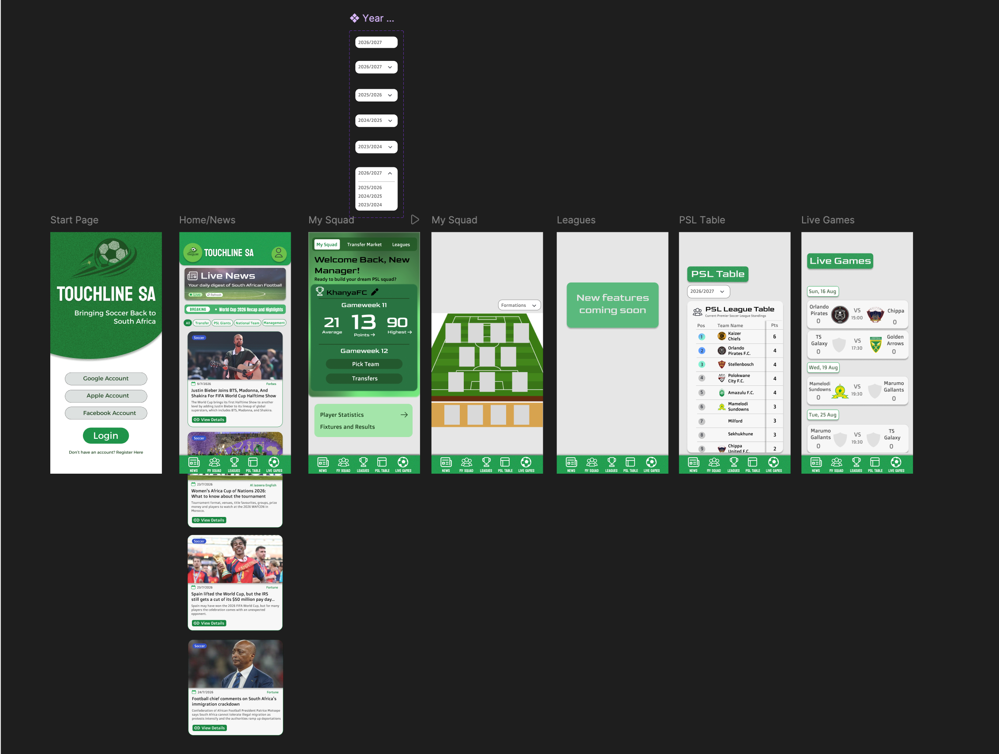

# Touchline UI concepts

[Open the Touchline design in Figma](https://www.figma.com/design/5ThVQkKeCdXaXEMloE6J7o/Untitled?node-id=0-1&t=TXrj17nz4DECa5b2-1)

The supplied screenshot covers the start page, home and news feed, squad dashboard, formation picker, leagues placeholder, PSL table and live games. The season selector variants appear above the mobile screens.

The start-page concept includes a Google account button. The team's confirmed sign-in options are Facebook and Apple. See [Accounts and sign-in](../AUTH.md) when implementing this screen.
